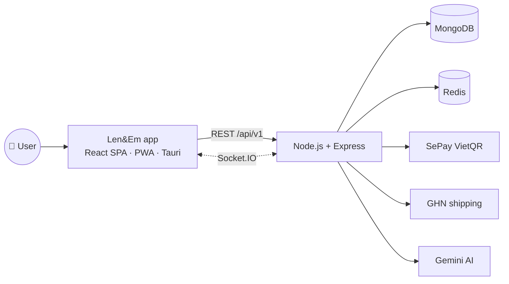

<div align="center">


# Len&Em

**Learn it. Shop it. Make it.**

A crochet store, a learning academy and a maker community — in one fast, real-time, installable app.

<a href="https://len-em.vercel.app"></a>
<a href="https://github.com/Kamui6607/Len-Em/releases"></a>


[Features](#-features) · [Architecture](#-architecture) · [Tech stack](#-tech-stack) · [Getting started](#-getting-started) · [Project structure](#-project-structure) · [Deployment](#-deployment)

</div>

<br />

## 🧶 At a glance

<table>
  <tr>
    <td width="33%" valign="top">
      <h3>🛍️ Shop</h3>
      Yarn, hooks and ready-to-go kits with color variants and live stock. Real GHN shipping fees, an address book with map pins, and checkout by <b>SePay VietQR</b> or <b>COD</b>.
    </td>
    <td width="33%" valign="top">
      <h3>🎓 Learn</h3>
      Free video lessons, structured courses from beginner to advanced, lesson-by-lesson progress, and premium courses unlocked with one QR payment.
    </td>
    <td width="33%" valign="top">
      <h3>🎨 Create</h3>
      A DIY feed where makers post their work, tag the materials they used, and support each other's creations.
    </td>
  </tr>
</table>

<br />

## ✨ Features

<details open>
<summary><b>🛍️ E-commerce</b></summary>
<br />

- **Catalog** — products, color variants and kit bundles with filters, search and sorting
- **Cart & wishlist** — kit savings, "add all to cart" from favorites
- **Checkout** — saved address book (pick province/district/ward *or* pin on a map), live GHN shipping quote
- **Payments** — SePay VietQR shown in-page with automatic confirmation, or cash on delivery
- **Orders** — real-time status updates, order history, cancellation and refund requests
</details>

<details>
<summary><b>🎓 Learning</b></summary>
<br />

- Free quick-tutorial videos — no account needed
- Courses grouped by skill level with per-lesson progress tracking
- Premium courses unlocked after a SePay payment
- Every course links the exact yarn, tools and kits it uses
</details>

<details>
<summary><b>🎨 Community</b></summary>
<br />

- DIY feed with photo posts and material tags
- Support / upvote fellow makers
- Admin moderation keeps the feed on-topic
</details>

<details>
<summary><b>👤 Accounts & membership</b></summary>
<br />

- Email/password and Google sign-in, OTP password reset
- Step-by-step sign-up that flags a duplicate email, username or phone on the step where it's entered
- Escalating lockout after repeated failed logins (5 min, then doubling), with a warning before it kicks in
- Membership tiers and loyalty coins that can be spent at checkout
</details>

<details>
<summary><b>🔧 Staff & admin</b></summary>
<br />

- Role-based dashboards for **User · Creator · Staff · Admin**
- Analytics with charts and KPIs
- Manage products, kits, courses, lessons, videos, users and roles
- Orders, refunds and reports, activity log, broadcast notifications
</details>

<details>
<summary><b>⚡ Everywhere else</b></summary>
<br />

- 🔔 Live notifications and messaging over Socket.IO
- 🤖 AI chatbot for product and crochet questions
- 🌙 Light and dark themes
- 📱 Mobile-first layout with bottom navigation and pull-to-refresh
- 📲 Installable PWA, plus Tauri apps for Windows, macOS, Linux and Android
- 🎬 Three.js scenes and scroll-driven motion
</details>

<br />

## 🏗 Architecture



This repository holds the **frontend**. The backend is a separate Node.js/Express service deployed on Render; in development, Vite proxies `/api`, `/socket.io` and `/notifications` to it.

<br />

## 🛠 Tech stack

| Area | Tools |
|---|---|
| **Core** | React 18 · TypeScript 5.8 · Vite 8 · React Router 7 |
| **Styling** | Tailwind CSS 4 · Radix UI primitives · Lucide icons · Motion |
| **Data** | TanStack Query 5 · Zustand 5 · Axios · Socket.IO client |
| **Forms** | React Hook Form · Yup |
| **Visuals** | Three.js / React Three Fiber · Recharts · Leaflet |
| **Platforms** | vite-plugin-pwa · Tauri 2 (desktop & Android) |
| **Backend** | Node.js · Express · MongoDB / Mongoose · Redis · JWT |

<br />

## 🚀 Getting started

**Requirements:** Node.js ≥ 20.19 (22 LTS recommended) and npm ≥ 9.

```bash
git clone https://github.com/Kamui6607/Len-Em.git
cd Len-Em/FE
npm install
npm run dev
```

Open **http://localhost:5173**. The dev server proxies API and socket traffic to the hosted backend, so no `.env` is needed to start.

<details>
<summary><b>Environment variables</b></summary>
<br />

Create `FE/.env` only if you need to override the defaults:

| Variable | Purpose |
|---|---|
| `VITE_API_BASE_URL` | Backend base URL for production builds (leave empty in dev to use the proxy) |
| `VITE_GOOGLE_CLIENT_ID` | Google OAuth client ID for "Sign in with Google" |
</details>

| Command | What it does |
|---|---|
| `npm run dev` | Start the dev server with HMR |
| `npm run build` | Type-check and build for production |
| `npm run preview` | Serve the production build locally |
| `npm run lint` | Run ESLint |
| `npm run tauri` | Run or build the desktop / Android app |

> **Tip:** if the browser shows `504 (Outdated Optimize Dep)`, stop the dev server, run `npm run dev -- --force`, then hard-reload the page.

<br />

## 📁 Project structure

```
FE/
├── src/
│   ├── app/          # App shell and pages, grouped by domain (shop, auth, admin, staff, creator…)
│   ├── features/     # Domain modules — services, types and stores per feature
│   ├── shared/       # Reusable API clients, components, contexts, hooks, stores, types
│   ├── lib/          # Axios client, query client, error parsing and small helpers
│   ├── routes/       # Route table and guards
│   ├── locales/      # Vietnamese strings (vi.json)
│   └── styles/       # Theme tokens and page styles
├── public/           # Static assets and PWA icons
├── src-tauri/        # Tauri 2 shell for desktop and Android
└── vite.config.ts    # Dev proxy, PWA manifest, chunk splitting
```

<details>
<summary>Full <code>src/</code> tree</summary>

```
src/
├── main.tsx               # Entry point
├── app/
│   ├── App.tsx            # Providers + router
│   └── pages/
│       ├── admin/         # Admin dashboard & management
│       ├── auth/          # Login, register, forgot/reset password
│       ├── creator/       # Creator dashboard
│       ├── manage/        # Staff order management
│       ├── membership/    # Membership & coins
│       ├── shop/          # Cart, checkout, orders
│       ├── staff/         # Staff dashboard & reports
│       ├── supportDIY/    # Support DIY
│       └── *.tsx          # Home, Shop, ProductDetail, Learn, DIY, Addresses, Profile…
├── features/              # creator · diy · learn · membership · orderReport · orders · shop · supportDIY · users
├── lib/                   # axiosClient, queryClient, apiError, loginError, formatPrice, authUtils…
├── locales/               # vi.json
├── routes/                # AppRouter
├── shared/
│   ├── api/               # auth, address, product, kit, course, lesson, ghn, shipping, chatbot…
│   ├── components/        # address · admin · auth · dashboard · filters · layout · map · mobile · motion · order · ui…
│   ├── contexts/          # Cart, Favorites, Theme, Language, Notification, Admin…
│   ├── hooks/
│   ├── store/             # Zustand (auth)
│   └── types/
├── constants/
└── styles/
```
</details>

<br />

## 🚢 Deployment

| Target | How |
|---|---|
| **Web / PWA** | Static SPA on Vercel — `vercel.json` rewrites every route to `index.html` |
| **Desktop & Android** | Pushing an `app-v*` tag runs GitHub Actions, which builds the Tauri installers and APK and attaches them to a GitHub Release |
| **Backend** | Separate repository, deployed on Render |

Secrets live in git-ignored env files and hosting settings — none are committed to this repository.

<br />

## 🤝 Contributing

1. Create a branch: `git checkout -b feat/your-feature`
2. Commit using [Conventional Commits](https://www.conventionalcommits.org/) — `feat:`, `fix:`, `refactor:`, `style:`, `docs:`, `chore:`
3. Run `npm run lint` and `npm run build`
4. Open a pull request

<br />

## 📄 License

Built for educational purposes as part of the **EXE101** course at **FPT University**.

<br />

<div align="center">
  <sub>Made with ❤️ and 🧶 by the Len&Em team</sub>
</div>
